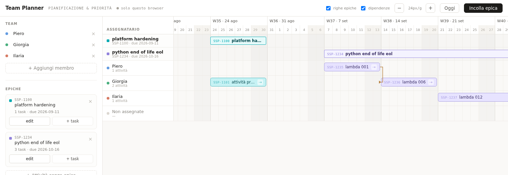

# Team Planner

Planner / Gantt su schermata singola per pianificare **epiche** e **attività**
di un team. Implementato a partire dal componente Claude Design
`Team Planner.dc.html` (progetto _"Tool pianificazione team Gantt"_).

L'interfaccia è in italiano, come il design di partenza.



## Avvio

```bash
npm install
npm run dev      # http://localhost:5173
```

```bash
npm run build    # type-check + build di produzione in dist/
npm run preview  # serve la build di produzione
```

```bash
npm run build:artifact   # build + dist/artifact.html, pagina unica da pubblicare
```

`dist/artifact.html` è pubblicato come Artifact con la capability `db`:
<https://claude.ai/artifact/WvdZCicv6BJNEPM4nT2kXV> (privato, condivisibile
dal menu Share). Per aggiornarlo: rifai la build e ripubblica lo stesso file
dalla sessione Claude Code; i dati nel DB restano.

## Cosa fa

- **Le righe sono gli assegnatari.** Ogni membro del team ha una corsia; le
  barre che si sovrappongono si impilano in sotto-corsie. Una corsia
  _"Non assegnate"_ raccoglie il lavoro senza assegnatario.
- **Trascina una barra** per spostarla nel tempo; trascinala sulla corsia di un
  altro assegnatario per riassegnarla; trascina il bordo sinistro/destro per
  ridimensionarla (cambiare la durata).
- **Maniglia ⇢** su una barra: avvia un vincolo _"deve iniziare dopo"_ — clicca
  la barra successiva per creare il collegamento. Le attività dipendenti vengono
  spinte in avanti automaticamente perché non inizino mai prima della fine della
  precedente. I vincoli sono disegnati come frecce a gomito.
- **Righe epica** (toggle _"righe epiche"_ nell'header): mostrano una barra
  riassuntiva che copre l'intervallo delle attività dell'epica.
- **Pannello di dettaglio** (clic su una barra): modifica key, titolo, tipo
  (task/bug), epica, assegnatario, data di inizio, durata e dipendenze.
- **Incolla epica**: apre una casella in cui incollare epiche e attività in un
  formato testo leggero _oppure_ un export di Jira.
- **edit** su una card epica: riapre quell'epica nello stesso formato testo.
- **Toggle _righe epiche_ / _dipendenze_** nell'header: nascondono/mostrano le
  righe riassuntive delle epiche e le frecce dei vincoli (nel design originale
  erano due _tweak_ dell'editor Claude Design).
- **Persistenza**: pubblicato come Artifact su claude.ai, i dati stanno in un
  database condiviso (un documento per membro, epica e attività, sincronizzato
  live tra chi apre la pagina). In locale (`npm run dev`) restano in
  `localStorage` con chiave `team-planner-v1`. L'indicatore nell'header mostra
  dove si sta salvando. Lo zoom resta una preferenza del singolo browser.

## Come importare e modificare le epiche

Vedi la **[guida dedicata](docs/guida-epiche.md)** per il formato testo, l'import
in blocco, la modifica di un'epica esistente, le date e le dipendenze.

Formato minimo:

```
epic: SSP-1234 python end of life eol
- task: SSP-1235 lambda 001 @piero 5d
- task: SSP-1236 lambda 006 @giorgia 5d >2026-09-14
start: 2026-09-07
due date: 2026-10-16
```

## Statuto: lavorare con gli LLM

Il progetto si sviluppa con più strumenti Claude, ognuno con il suo ruolo.
Le regole operative complete sono in [CLAUDE.md](CLAUDE.md), letto da ogni
istanza di Claude; quelle valide su una sola macchina stanno in
`CLAUDE.local.md`, non versionato (se dicono cose diverse vale `CLAUDE.md`).

| Chi | Ruolo | Legge | Scrive |
| --- | --- | --- | --- |
| **claude.ai** | ideazione: idee, gusti, decisioni aperte | il repo, la roadmap | proposte e decisioni, da riportare in [docs/roadmap.md](docs/roadmap.md) |
| **Claude Design** | design: interfaccia, aspetto, componenti. È la fonte del design | il progetto Claude Design (`Team Planner.dc.html`) | il design, non il codice |
| **Claude Code** | sviluppo: codice, build, documenti | tutto il repo, il design | branch `feature/<nome>` |
| **GitHub** | contratto e controllo: branch, PR, merge | - | - |
| **Piero** | decide, rivede, mergia | tutto | le decisioni, l'ok ai commit, il merge |

**Principi**

- **Il design è curato da Claude Design.** Il codice lo segue: una differenza
  tra app e design si porta in Claude Design o si registra come decisione
  nella roadmap, mai risolta in silenzio nel codice. Le modifiche grafiche
  si propongono con un'anteprima visiva (screenshot o varianti a confronto),
  non solo a parole.
- **Mai commit diretti su `main`.** Si lavora su `feature/<nome>` e si entra
  con una PR su GitHub, che Piero rivede e mergia (merge commit, non squash).
  Un branch lungo si aggiorna con `git merge main`, mai con rebase o force
  push.
- **Prima di ogni commit** Claude mostra le modifiche e aspetta l'ok. Commit
  piccoli e coerenti, `npm run build` verde a ogni commit, aggiunti per nome
  (mai `git add .`).
- **Ogni lavoro ha un codice** (`GNT-NN` app, `WF-NN` flusso di lavoro),
  registrato in [docs/roadmap.md](docs/roadmap.md) con il suo stato. Formato
  del commit: `<codice>: <descrizione> | <label>`.
- **Le decisioni stanno nella roadmap** (D1, D2, ...), con data e motivo.
  Quando Claude cita una decisione con il suo codice, la riassume in una riga
  in una legenda a fine messaggio.
- **Niente dati riservati nei prompt.** Il Jira aziendale è protetto: entra
  solo come testo incollato da Piero, senza credenziali né connettori.
- **Il chatbot riferisce il vero:** se un test o una build falliscono, o un
  passo è saltato, lo dice.
- Niente righe di attribuzione né trattino lungo (U+2014) in commit e PR.

## Roadmap

Piano di lavoro, task e decisioni aperte: [docs/roadmap.md](docs/roadmap.md).

## Struttura del progetto

| File | Ruolo |
| --- | --- |
| `src/types.ts` | Modello di dominio (`Member`, `Epic`, `Task`, `PlannerData`, output del parser) |
| `src/logic.ts` | Helper puri: calcoli su date, settimana ISO, palette di tinte, scheduling delle dipendenze, parser/serializzatore del formato testo, e l'helper `css()` per gli stili inline |
| `src/TeamPlanner.tsx` | Il componente: stato, gestori di drag/resize/link, import + modifica epica, costruzione del view-model, render |
| `src/store.ts` | Persistenza: `localStorage` in locale, sincronizzazione col DB dell'Artifact (diff per documento, scritture raggruppate) |
| `scripts/build-artifact.mjs` | Inline di JS/CSS della build in `dist/artifact.html` |
| `src/main.tsx` | Entry point React |
| `src/styles.css` | Stili globali (dal blocco `<helmet>` del design) |

## Stack

Vite · React 18 · TypeScript. Nessun backend proprio: il DB è quello
dell'Artifact claude.ai; in locale si usa `localStorage`.
